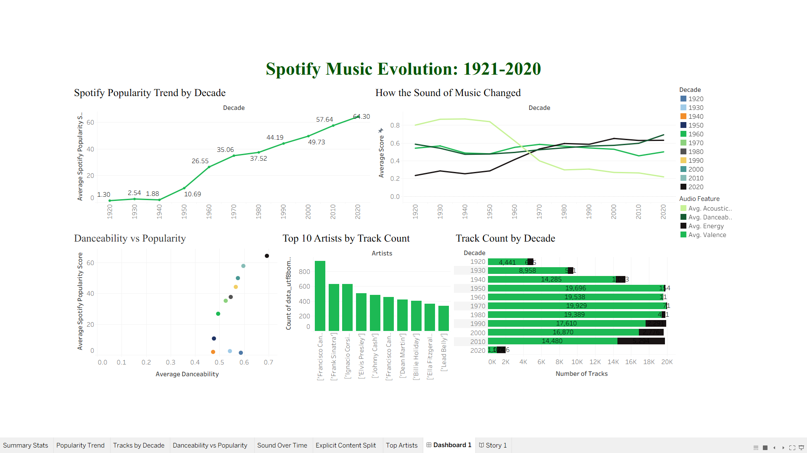
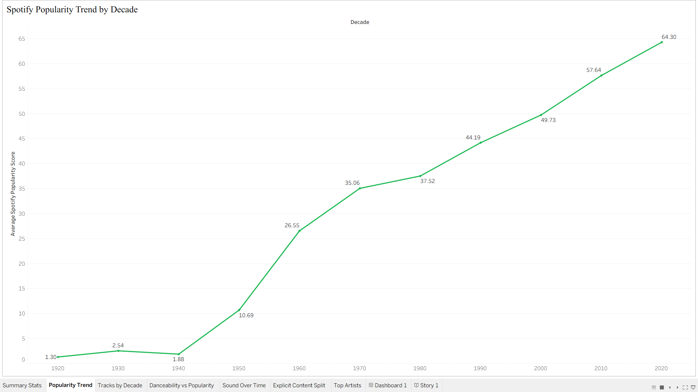
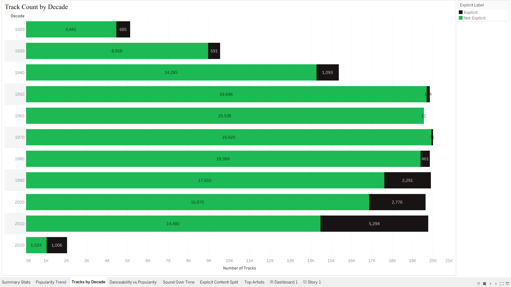
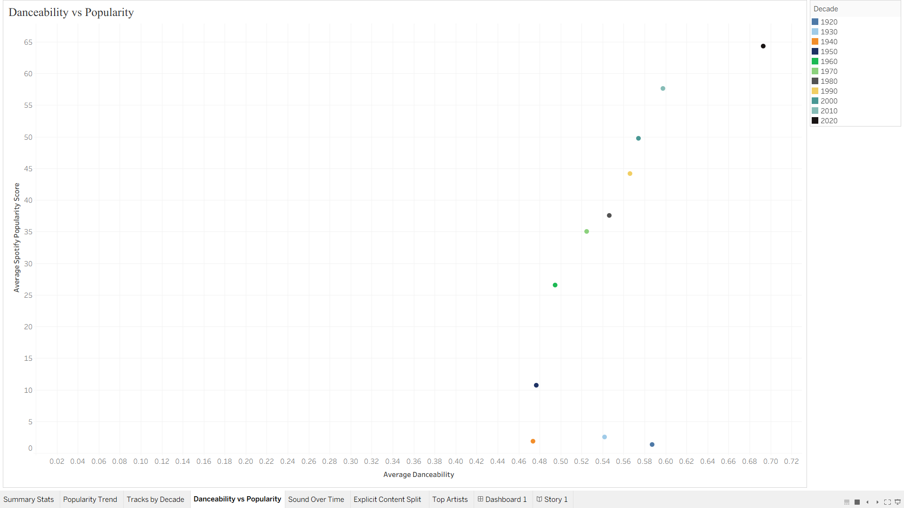
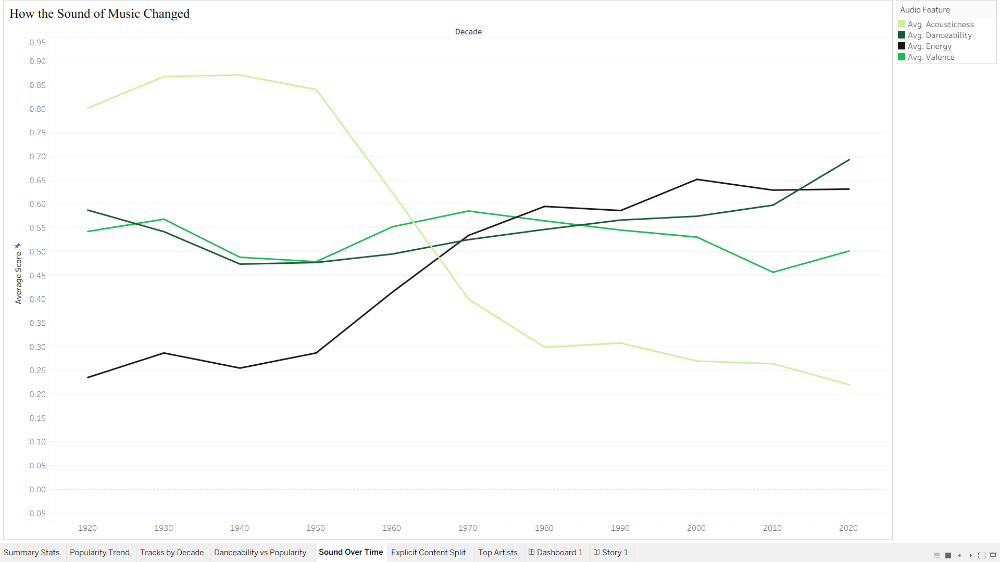
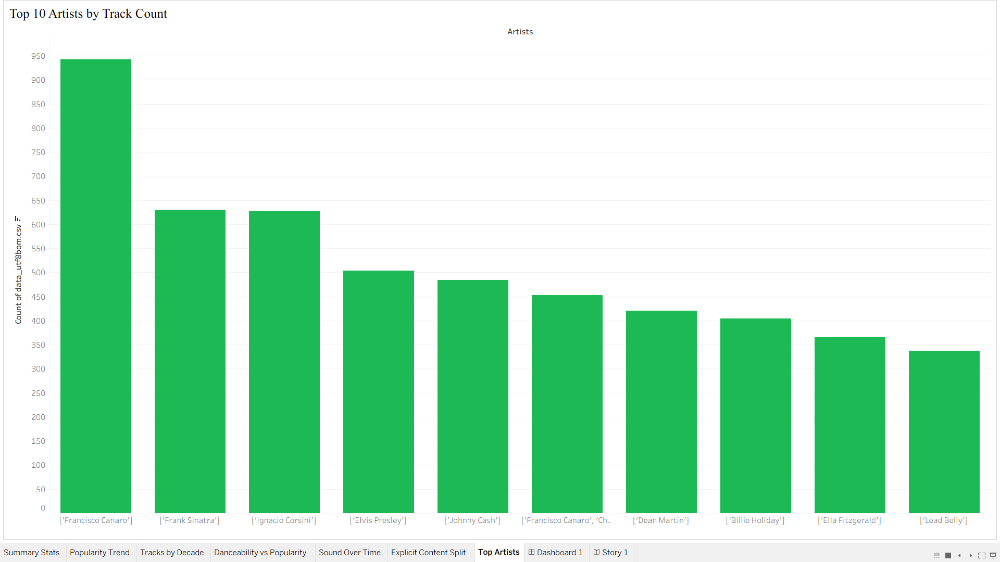

# Spotify Music Analysis Dashboard
## Project Overview
### Dashboard Preview

This project explores historical Spotify music data from 1921 to 2020 using Tableau. The aim is to understand how music popularity, track distribution and audio characteristics have changed over time.
An interactive Tableau dashboard and story were developed to explore different aspects of music trends and present findings through data visualizations.

## Project Objectives
- Explore average music popularity trends over time.
- Compare the number of tracks across different decades.
- Investigate the relationship between danceability and popularity.
- Analyse changes in music audio characteristics over time.
- Identify artists with the highest number of tracks.

## Tableau Storytelling
The project includes the following visualizations:

### 1. Popularity Trend
Explores the average popularity of music tracks across different years to identify changes in popularity over time.

### 2. Tracks by Decade
Compares the number of music tracks across different decades to understand the distribution of tracks over time.

### 3. Danceability vs Popularity
Explores the relationship between danceability and popularity to identify patterns among music tracks.

### 4. Sound Over Time
Analyses changes in music audio characteristics, including danceability, energy, acousticness and valence, over time.

### 5. Top Artists
Identifies artists with the highest number of tracks in the dataset and compares their contributions.

## Tools and Technologies
- Tableau
- Spotify Historical Tracks Dataset

## Key Skills Demonstrated
- Data Visualization
- Exploratory Data Analysis
- Trend Analysis
- Interactive Dashboard Development
- Data Storytelling

## Project Files
- `spotify_music_analysis.twbx` – Packaged Tableau workbook.
- PNG files – Dashboard and visualization screenshots.

## Author
**Amandi Sankalpani**

Business Analytics Undergraduate  
NSBM Green University
